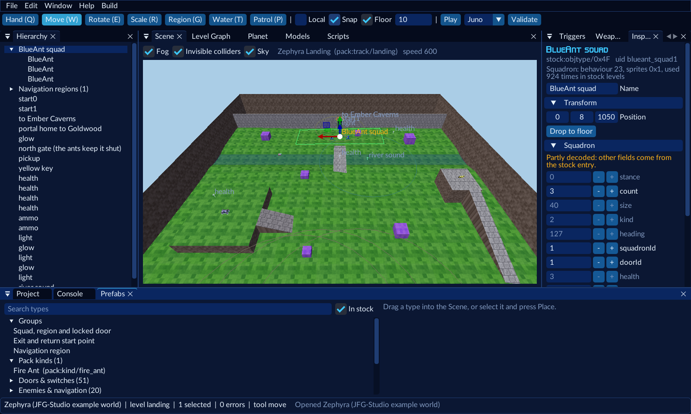

# JFG-Studio

A standalone level and modpack editor for
**[Jet Force Gemini: Recompiled](https://github.com/VibinToast/JetForceGemini-Recomp)**. It builds `.nrm` packs the
game loads from its Mods list. You need your own US ROM; nothing from the game is in this repository or in what it
ships.

**Documentation, tutorials and the modding API: [the JFG Modding Wiki](https://jfg.vibintoast.com)** (coming soon).



## What it does

- **Levels on your own geometry**: import a `.glb` from Blender (the jfg64 add-on helps), with water, lava, kill
  floors and invisible walls, fog, sky, music and lighting settings. Or add to one of the game's own levels without
  replacing it.
- **Place anything the game has**: ant squads that lock doors until they're dead, navigation regions and patrol
  networks, keys and key doors, chests, crates, pickups, lights, sounds, exits and start points, with a 3D Scene,
  gizmos, snapping and drop-to-floor.
- **Planets and galaxies**: put planets on the game's map or on a galaxy of your own, with routes and unlocks
  (hidden until the world before is completed, or until found).
- **New enemy looks**: reskin a stock enemy with your own textures and size as its own type.
- **Triggers without code** (messages, talkers, music, fog, doors, spawns, warps, planet unlocks) and **Lua scripts**
  for the rest; **weapon tuning** (damage, rate, speed, range, spread).
- **Custom music**: your own OGG tracks per level, with loop points.
- **Validate, build, play**: checks the project against the game's rules as you edit, builds the pack, installs it
  in the port and starts the game in your level with one button.

The example world, `samples/zephyra.jfgproj` (a galaxy of three planets and five levels), shows all of it.

The design and the plans are in the JFG-Modding repo (`Docs/`): `JFG_STUDIO_DESIGN.md`, `PHASE0_TASKS.md`,
`MODDING_API_PLAN.md`. In the usual layout this repo sits in `JFG-Modding-Tools/JFG-Studio`, so they are at
[../Docs](../Docs).

## Commands

| Command | What |
|---|---|
| `jfgstudio` / `jfgstudio gui [project]` | the editor |
| `jfgstudio new <folder> --id <mod id> --name <name>` | an empty project |
| `jfgstudio validate <project>` | checks a project against the game's rules |
| `jfgstudio catalog` | decodes your ROM into the local catalog (your data folder) |
| `jfgstudio build <project> [-o pack.nrm]` | builds the pack |
| `jfgstudio test <project>` | builds, installs into the port's `mods` and starts the game in the level |

The sample planet: `jfgstudio test samples/gemini.jfgproj` (its ground is drawn by `samples/make_gemini_field.py`).

## Run from source

```
python -m venv .venv
.venv/Scripts/python -m pip install -e .[dev]     # Linux: .venv/bin/python
.venv/Scripts/python -m jfgstudio                  # the editor
.venv/Scripts/python -m jfgstudio --help           # the command line
.venv/Scripts/python -m unittest discover -s tests -t .   # tests (no ROM needed)
```

## Settings

`jfgstudio settings` shows them; `jfgstudio settings set <key> <path>` sets one. Kept in the user's config folder,
never in a project.

| Key | What |
|---|---|
| `decomp` | the decomp checkout; Studio imports `tools/jfgformats` from it |
| `port` | the Jet Force Gemini: Recompiled folder (for fonts, `bin/mods` and test runs) |
| `rom` | your own US ROM (used only to build the local catalog) |
